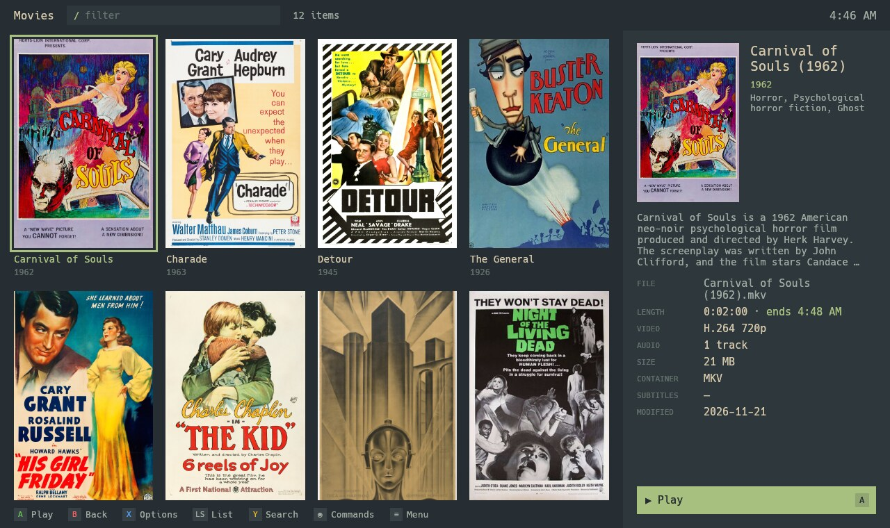
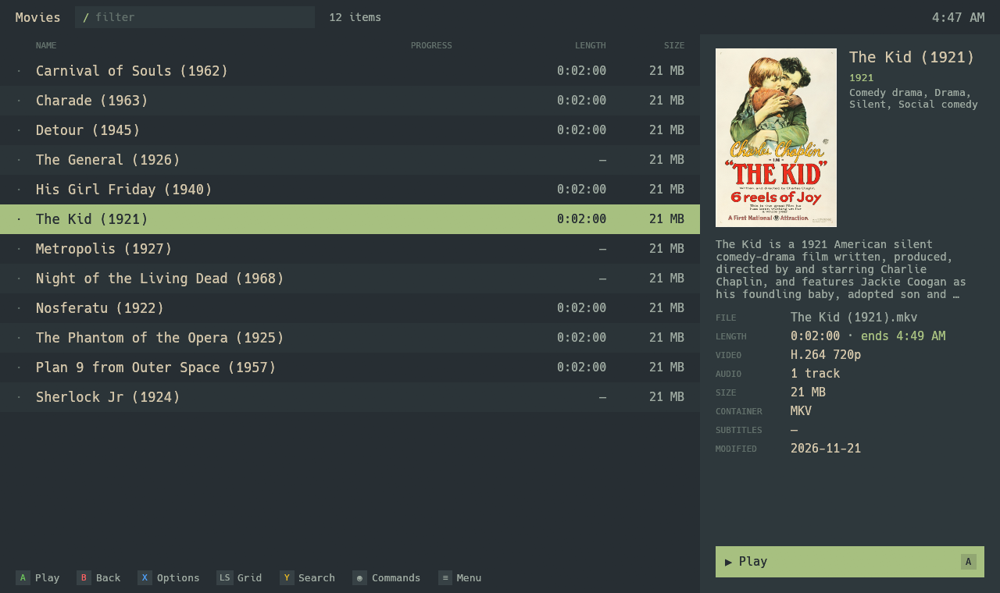

<h1 align="center">jimmy</h1>

<p align="center">
  A lightweight, gamepad-friendly media player and library for old hardware.<br>
  Rust + egui (OpenGL) + libmpv. No webview, no GTK/Qt.
</p>

<p align="center">
  <a href="https://github.com/owallzz/jimmy/actions/workflows/ci.yml"></a>
  <a href="LICENSE"></a>
</p>

<p align="center">
  
</p>

## Features

- Plays anything FFmpeg/mpv can play, with hardware decoding where available
- Movie and TV libraries with posters, descriptions and episode tracking, matched without API keys (TVmaze, Wikipedia, Wikidata)
- Media browser built for slow disks (no file probing, idle I/O priority)
- Full gamepad control (Xbox and PlayStation button labels), keyboard with vim keys, and mouse
- Command palette, remappable keyboard and gamepad controls
- Subtitles and closed captions (SRT, ASS, PGS, VobSub, EIA-608), on-demand subtitle downloads, resume positions
- System volume with boost up to 200%, system backlight control
- 20 color schemes (Everforest by default)

<p align="center">
  
</p>

## Install

Download from the [latest release](https://github.com/owallzz/jimmy/releases/latest). Every build
has mpv and FFmpeg built in (every decoder and container). Posters, library metadata and subtitle
downloads use the system's `curl`, which Windows 10/11, macOS and most Linux distros include
(on a minimal Debian/Ubuntu install: `sudo apt install curl`).

| System | File |
|---|---|
| Windows 10/11 (x64) | `jimmy-*-windows-x86_64-setup.exe`, or `*-portable.exe` to run without installing |
| macOS 11+ (Apple Silicon and Intel) | `jimmy-*-macos-universal.dmg` |
| Linux x86_64 (glibc 2.34+: Ubuntu 22.04, Debian 12, Fedora, RHEL 9 and newer) | `.flatpak`, `.AppImage`, `.rpm`, or the standalone `jimmy-*-linux-x86_64` |

**Linux**

```bash
flatpak install --user ./jimmy-*-x86_64.flatpak     # Flatpak
sudo dnf install ./jimmy-*.x86_64.rpm               # Fedora / RHEL
chmod +x jimmy-*-linux-x86_64 && ./jimmy-*-linux-x86_64 --install   # standalone
```

`--install` copies the binary to `~/.local/bin/jimmy` and adds a launcher and icon to the app
menu (add `--default` to make it the default video player). `jimmy --uninstall` removes them.
The AppImage runs as is after `chmod +x`. The Flatpak is sandboxed, so system volume, backlight
control and keeping the screen awake during playback aren't available in it.

**Windows:** the installer and exe aren't code-signed, so SmartScreen may warn the first time:
choose *More info → Run anyway*. The installer adds jimmy to the Start menu and to *Open with*
for video files. The volume control sets jimmy's own volume (not the system's), and there is no
backlight control.

**macOS:** the app isn't notarized. After macOS blocks the first launch, open *System Settings →
Privacy & Security* and choose *Open Anyway* (or run
`xattr -dr com.apple.quarantine /Applications/jimmy.app`). There is no backlight control on macOS.

Gamepads: Xbox controllers work out of the box. PS5 DualSense works over USB or Bluetooth (on
Linux through the kernel's `hid-playstation` driver).

### Build from source

On Fedora, against the system libmpv (enable RPM Fusion first: Fedora's own ffmpeg can't decode
H.264/HEVC):

```bash
sudo dnf install https://mirrors.rpmfusion.org/free/fedora/rpmfusion-free-release-$(rpm -E %fedora).noarch.rpm
sudo dnf swap ffmpeg-free ffmpeg --allowerasing
sudo dnf install mpv-libs mpv-devel gcc systemd-devel
curl https://sh.rustup.rs -sSf | sh     # if Rust isn't installed
cargo build --release
./target/release/jimmy --install
```

On macOS for development: `brew install mpv && cargo run -- ~/Movies`. The static release builds
for every platform are described in [packaging/README.md](packaging/README.md).

## Controls (defaults, all remappable in Settings → Controls)

| | Keyboard | vim | Gamepad |
|---|---|---|---|
| Move | ↑ ↓ | j k, `5j`, gg / G, Ctrl+D / Ctrl+U | D-pad, left stick |
| Open / up a folder | Enter, → / Backspace, ← | l / h | A (✕) / B (○) |
| Play from start / add folder to library | Shift+Enter | o | X (□) |
| Search (filter the list) | / | / | Y (△): on-screen keyboard |
| Command palette | Ctrl+P | : | Guide (Xbox / PS button); Y (△) inside it types |
| Menu (My media, folders, settings) | Tab | | ≡ |
| Close a menu | Esc | q | B (○) |
| Play / pause | Space | | A (✕) |
| Seek ±10 s / ±60 s | ← → / Shift+← → | h l / H L | D-pad ◀ ▶ / LB RB |
| Volume | ↑ ↓ | k j | D-pad ▲ ▼ |
| Brightness | PgUp / PgDn | | right stick ▲ ▼ |
| Subtitles / audio track | C / A | | X (□) / Y (△); hold X (□) to pick from a list |
| Tracks panel | T | | ≡ |
| Stop | Backspace | q | B (○) twice |
| Fullscreen | F11, F (player) | | View |

jimmy opens on **My media** (everything in your library folders). Back goes up one folder; at the top of
a tab (My media, Continue watching, a library folder…) it opens the menu instead, so you only switch
tabs from the menu. To add folders, open the menu → **Browse computer…**, move to a folder and
press X (□) (Shift+Enter on a keyboard); press it again to remove it. Library folders are tagged
`LIBRARY`.

In the browser, press `/` to filter: type, Enter keeps the filter, Esc clears it. With a controller,
Y (△) opens an on-screen keyboard: D-pad/stick moves, A (✕) types, X (□) deletes, Y (△) adds a space,
B (○) or ≡ finishes. Results filter live while you type. Settings (`config.toml`,
`bindings.toml`) and history (`state.toml`) live in `~/.config/jimmy/` and `~/.local/share/jimmy/`
on Linux (`~/.var/app/io.github.owallzz.jimmy/` in the Flatpak), `~/Library/Application Support/jimmy/`
on macOS, and `%APPDATA%\jimmy\` on Windows.
The clock is 12-hour by default; switch to 24-hour in Settings → General.

## Libraries, TV shows, movies and playlists

- **Libraries are typed, like Plex.** Adding a folder (Browse computer… → X, or Settings →
  Library) asks whether it holds **Movies** or **TV Shows**; ◀ ▶ on a library in Settings
  switches it. Old folder lists are converted automatically.
- **TV libraries:** each top-level folder is a show, matched by its name:
  `Show (Year) {tmdb-1396}` or `{tvdb-…}` / `{imdb-…}` hints skip the search. Inside:
  `S01E02`, `1x02`, multi-episode `S01E01-E02`, dates (`2024-03-05`), absolute numbers
  (`Show - 105`, mapped to seasons once matched), `Specials/` = season 0, split files
  (`- pt1`, `cd2`).
- **Movie libraries:** one movie per `Title (Year)` folder or per file; split movies play
  their parts back to back.
- **Matching, no API keys:** shows from TVmaze; movies from Wikipedia (summary, poster) and
  Wikidata (year, genres, IMDb ID). Local `tvshow.nfo`, `movie.nfo`, `poster.jpg`,
  `fanart.jpg` and `season01-poster.jpg` are used first. Everything lands in
  `library.json`, keyed by TVmaze / Wikidata ID. The libraries are rescanned in the
  background (at startup and every 10 minutes) so new files appear on their own.
- **Fix Match** (M, or from the palette): search TVmaze or Wikipedia and pick the right one; your
  pick sticks.
- **Art:** posters, season posters, episode thumbnails and background art, downloaded only
  when shown and shrunk once. A show's page in grid view is a wall of episode thumbnails.
- **Recently added** in the menu lists the newest files.
- **TV shows** page: season tabs (LT/RT, `[` `]`, or left/right), what's watched and next;
  X on a show plays its next episode. Playing an episode queues the rest of the show, with
  an **Up next** countdown (A plays now, B cancels). In the player: **Episodes** (E, LS),
  next / previous episode (Shift+. / Shift+, or the right stick), **frame step** with `.`
  and `,`.
- **Repeat** (R in the player) and **When a video ends** (go back, or stay with Replay /
  Back) are in Settings → Playback and the Episodes tab.
- **Playlists** are `.m3u8` files: P (right-stick click) adds a video, a show or a playlist.
- **Grid view** (V, or left-stick click) for Movies, TV shows, My media, Recently added,
  Continue watching, Recent and playlists.
- **Download subtitles** on demand: hold the Subs button and pick “+ Download subtitles…”
  (also in Tracks → Subs, D, or the palette). Results come from OpenSubtitles.org, exact
  matches for your file first; the one you pick is added and selected, and comes back every
  time you play that video. No account or key needed. Languages: `sub_languages = "en,es"`.
- Settings → Library → **Clear watch history** forgets positions and watched marks.
- To forget just one movie (all its versions), episode or whole show, pick **Clear watch history** in its Options menu (□ / X / Shift+Enter). It also drops out of Continue watching and Recent.

## Command line

```
jimmy [FILE | FOLDER] [--fullscreen | --windowed] [--size WxH]
jimmy --install [--default] | --uninstall    # Linux: add to / remove from the app menu
```

For testing, `--actions` runs a script of actions and can save screenshots:

```bash
jimmy ~/Videos --actions "wait:1000,down,accept,wait:3000,screenshot:/tmp/player.png,quit"
jimmy --actions "key:j,key:Slash,type:moon,key:Enter,quit"   # real key presses and typing
JIMMY_FAKE_PAD=ps jimmy ...   # show PlayStation button hints without a controller
JIMMY_HOME=/tmp/jimmy-test jimmy ...   # use a separate config/history folder
```

## Development

```bash
cargo build              # uses the system libmpv (mpv-devel on Fedora)
cargo test
```

Packaging, the static mpv/FFmpeg build and the release workflow are described in
[packaging/README.md](packaging/README.md).

## License

jimmy's source is MIT licensed. See [LICENSE](LICENSE). The release binaries include mpv
(GPL-2.0-or-later as built), FFmpeg and other libraries, so they are distributed under the GPL.
See [THIRD-PARTY.md](THIRD-PARTY.md).
